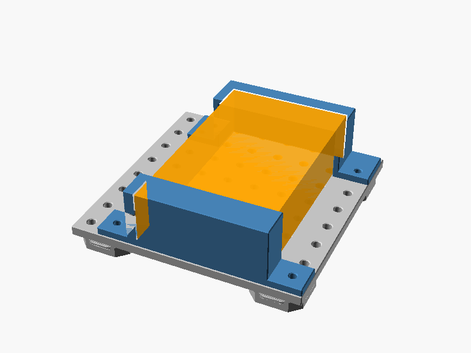
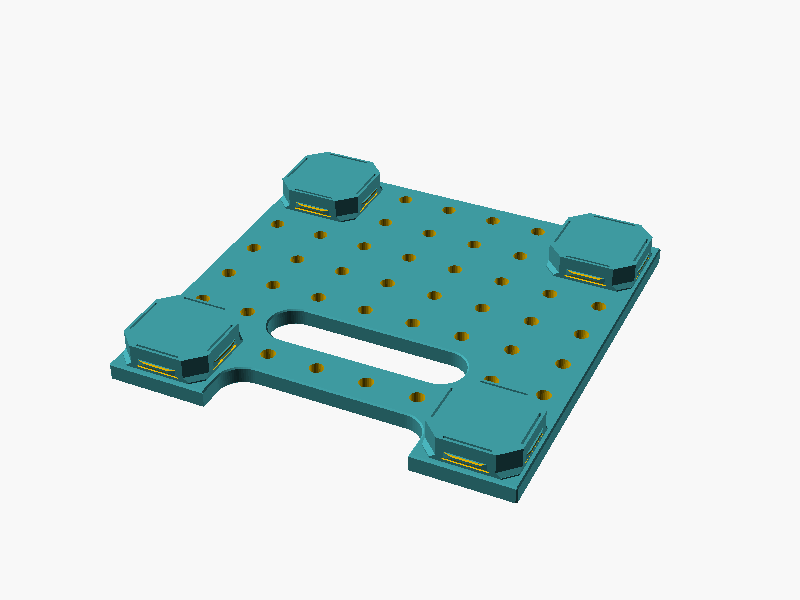
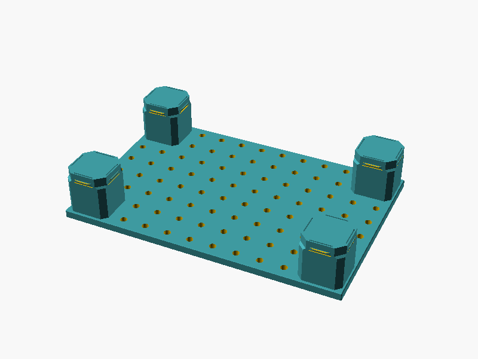
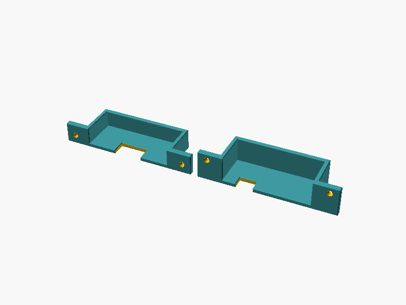
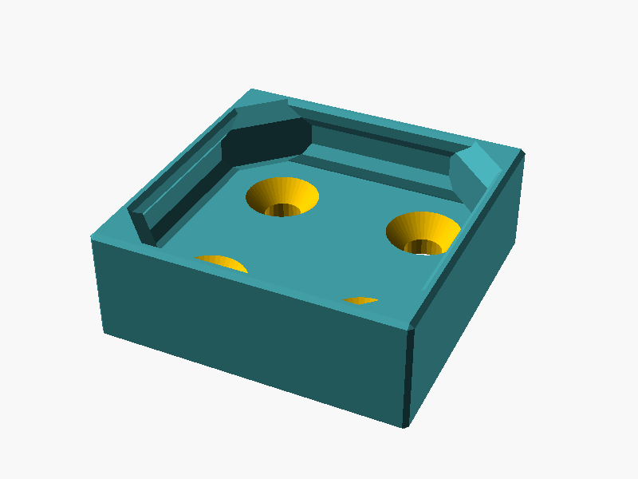
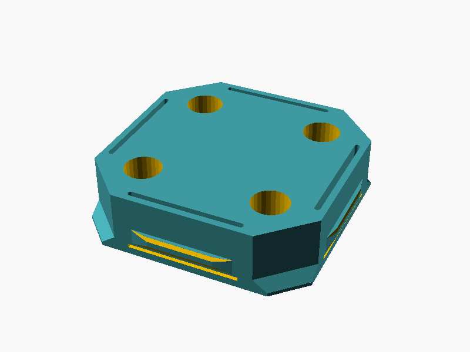

# gearplate

Parametric OpenSCAD generator for device mounting boards that snap onto an openGrid. Screw your device onto the board through M3 heat-set inserts; the board clicks into the grid with openGrid snaps at its corners.



## Parts

| | |
|---|---|
|  | **Gearplate** (`gearplate.scad`). Any size in 28 mm cells, with insert holes on a 14 mm grid that continues across neighbouring boards. Optional cable slots, which may open out of an edge. Full or Lite snaps. |
|  | **Posts.** `post_height` raises the board off the wall, e.g. for under-desk mounting. |
|  | **Device end caps** (`bracket.scad`). A pair of caps that hold a box-shaped device by its ends and screw onto the hole grid. Each cap's end wall gets its own cable/port notches. |
|  | **Stacking piece** (`stacking.scad`). A 1×1 openGrid tile that screws onto a gearplate, so the next gearplate can snap onto it. |
|  | **Holed snap** (`snap.scad`). A standalone openGrid snap with 2×2 insert holes on the gearplate pattern, so caps can screw onto loose snaps in the grid. |

## Usage

Requires [Task](https://taskfile.dev), `jq`, `curl` and `git`.

```sh
task setup     # download OpenSCAD nightly + BOSL2 into .tools/ (Linux x86_64)
task           # build every preset in *.json into out/*.stl
task stl P=4x4 # build one preset
task fit       # interactive: enter a device's size and cutouts, get the smallest plate + caps
task test      # logic checks
task images    # re-render the pictures in docs/
```

Presets are OpenSCAD Customizer parameter sets (`gearplate.json`, `bracket.json`, `stacking.json`, `snap.json`), so the `.scad` files also work in the OpenSCAD GUI. See [DESIGN.md](DESIGN.md) for parameters and design decisions.

None of the parts have been verified by printing yet.

## License

[CC BY-NC-SA 4.0](LICENSE). Includes vendored openGrid code: `opengrid-snap.scad` (openGrid by David D, OpenSCAD by metasyntactic, via [nnarain/opengrid-snap-mount-generator](https://github.com/nnarain/opengrid-snap-mount-generator)) and `opengrid-tile.scad` (openGrid by David D, OpenSCAD by BlackjackDuck, via [AndyLevesque/QuackWorks](https://github.com/AndyLevesque/QuackWorks)).
